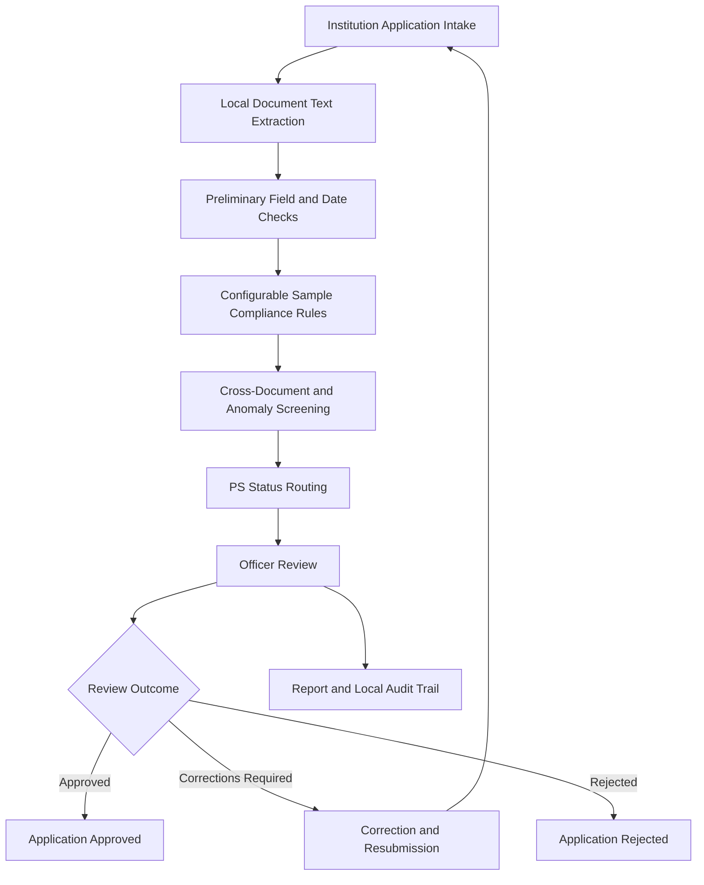

# 🔎 VerifyFlow — AI-Powered Application Validation & Regulatory Compliance

  **Team AuthenIQ | Smart India Hackathon 2026**

  *PS 26261 · AICTE Regulation Bureau*

  **Turning document-heavy application review into a structured, evidence-led workflow.**

  
  
  
  

---

## 📌 The Problem

Regulatory application review involves examining institutional information, supporting documents, validity dates and compliance requirements. Manual review can be demanding when information is incomplete, inconsistent or difficult to verify.

The challenge is not simply to extract text from documents. Reviewers need a structured way to identify potential issues, understand the evidence behind each finding, determine which checks remain unresolved and record their decisions.

**VerifyFlow addresses this workflow challenge through a browser-based decision-support prototype designed around PS 26261.**

## 💡 Our Solution

VerifyFlow brings application intake, local document text extraction, preliminary validation, configurable sample compliance rules, simulated source-verification scenarios and officer review into one workflow.

Instead of treating every automated flag as a final conclusion, VerifyFlow distinguishes preliminary findings from source-backed verification and leaves regulatory decisions to the responsible officer.

### 🎯 What makes VerifyFlow different?

- **Evidence-led review:** Findings are presented alongside available extracted text and application information.
- **Multiple verification states:** Six distinct statuses represent different outcomes and unresolved checks.
- **Explicit verification boundaries:** A simulated source response is never presented as live authentication.
- **Human-in-the-loop decisions:** Officers can review applications, provide reasons, request corrections or reject submissions.
- **Traceable workflow:** Application events and review actions are recorded in a local demonstration audit trail.

> **Core principle:** Automated checks assist the reviewer. They do not replace authorised regulatory decision-making.

---

## ⚙️ How VerifyFlow Works

*The diagram represents the prototype workflow. It does not imply live AICTE or issuing-authority connectivity.*

### 🧭 Workflow overview

| Stage | What happens |
|---|---|
| 01 · Application intake | Institution details and documents are submitted through the browser. |
| 02 · Text extraction | PDF.js extracts embedded PDF text; Tesseract.js provides OCR for supported scans and images. |
| 03 · Preliminary validation | Required fields, document categories, file compatibility and date conditions are checked. |
| 04 · Sample compliance checks | Illustrative registration, faculty and campus-area rules demonstrate configurable validation. |
| 05 · Consistency screening | Duplicate application patterns and selected institution-name inconsistencies are flagged. |
| 06 · Status routing | Documents are assigned an appropriate verification status based on the implemented checks and connector scenarios. |
| 07 · Officer review | The reviewer records comments and chooses an application outcome or requests corrections. |
| 08 · Reporting and audit | The prototype supports HTML reports, CSV exports, printing and a local action timeline. |

---

## 🛡️ Six Verification Statuses

VerifyFlow separates document verification status from the overall application decision.

| Status | Meaning in the prototype |
|---|---|
| 🟢 **Verified** | Reserved for a matching response from a real authorised source. Not achievable through the current simulated connector. |
| 🔴 **Mismatch Detected** | A conflict or preliminary inconsistency has been flagged. This does not prove forgery. |
| 🟠 **Expired** | The entered validity date is in the past. This is based on application metadata, not issuer confirmation. |
| 🔵 **Verification Pending** | Trusted-source confirmation is still needed, including after a simulated match. |
| ⚪ **Source Unavailable** | The simulated connector reports an unavailable source; this is not a real-world outage. |
| 🟣 **Manual Review Required** | Extraction is unavailable or inconclusive, or the result requires human examination. |

**Important:** These statuses are decision-support indicators. They are not proof of authenticity, fraud or regulatory non-compliance.

---

## ✨ Implemented Features

### 🏢 Institution Portal
- Create and submit an application.
- Enter institution and contact details.
- Select a document for each required category.
- Resubmit information after a correction request.

### 📄 Browser-Local Document Processing
- Extract embedded text from up to the first three PDF pages.
- Apply OCR to the first page of a scanned PDF.
- Apply OCR to JPG, JPEG and PNG images.
- Display an extracted-text preview and OCR confidence when available.
- Limit saved extracted text to 8,000 characters per document.

### 🧪 Preliminary Validation Engine
- Check required fields and document categories.
- Check filename extension and MIME-type compatibility.
- Evaluate entered validity dates and expiry conditions.
- Compare declared institution names with selected extracted text.
- Flag exact duplicate name/application-type combinations in local demo records.
- Identify selected cross-document inconsistencies.

### 🔌 Simulated Source Connector
Demonstrate synthetic outcomes such as:
- Matching response
- Mismatching response
- Source unavailable
- Inconclusive result requiring manual review

Every connector outcome is labelled:

**SIMULATED — NOT LIVE AUTHENTICATION**

A simulated match remains **Verification Pending** until an authorised real-source confirmation exists.

### 👨‍⚖️ Officer Review and Resubmission
- View the application queue.
- Review available findings and evidence.
- Add comments and reasons.
- Approve, request corrections or reject an application.
- Track correction and resubmission activity.

### 📊 Reporting and Audit
- Download an HTML report.
- Print or save the report as PDF.
- Export application data to CSV.
- View a local timestamped action log.

### 🧰 Repeatable Test Bench
- Exercise selected status-routing scenarios.
- Test expiry, mismatch, source-unavailable and manual-review paths.
- Check that a simulated match does not result in Verified.

The test bench evaluates selected deterministic routing cases, not real-world detection accuracy.

---

## 🧱 Technology Stack

| Technology | Role |
|---|---|
| HTML, CSS and JavaScript | Browser interface and application workflow |
| PDF.js | Embedded PDF text extraction and page rendering |
| Tesseract.js | Browser-based OCR for supported document scans and images |
| Browser `localStorage` | Local demo application data, extracted snippets and action history |
| Mermaid | Workflow documentation |

PDF.js and Tesseract.js are loaded through public CDNs. Their extraction features require network access to load the libraries.

**Architecture note:** The current prototype is frontend-only. It does not use a Python backend, database server, AI language model or external OCR API.

---

## 🔐 Privacy, Security and Responsible Use

VerifyFlow is designed to demonstrate a review workflow without uploading selected documents to a project backend.

- Selected files are processed locally in the browser for extraction.
- Extracted text snippets and associated metadata are saved in browser `localStorage`.
- The prototype does not connect to AICTE, DigiLocker or a live issuing authority.
- Role switching is a demonstration control, not secure authentication.
- Local storage and the audit trail are not encrypted, shared, server-side or tamper-proof.
- OCR and preliminary checks can produce errors and false positives.
- A reviewer must inspect the original document before drawing conclusions.

**Use fictional demonstration data only. Do not enter confidential institutional records or personal documents.**

---

## 🧪 Testing and Evaluation

The project includes a repeatable test bench for selected deterministic status-routing cases.

| Evaluation area | Current scope |
|---|---|
| Expiry handling | Selected entered-date scenarios |
| Mismatch routing | Synthetic conflict scenarios |
| Source unavailable | Simulated connector outcome |
| Manual review | Selected inconclusive or unavailable-extraction cases |
| Verification safeguard | Simulated match remains Verification Pending |

These checks demonstrate expected behaviour for selected scenarios. They do **not** establish OCR accuracy, forgery-detection performance, processing-time improvements or readiness for operational deployment.

---

## 🚧 Current Limitations

VerifyFlow is a functional demonstration prototype, not a production regulatory platform.

- Regulatory rules and thresholds are illustrative, not a complete validated implementation of the AICTE Approval Process Handbook.
- PDF extraction is limited to embedded text on the first three pages; scanned-PDF OCR processes only the first page.
- Text extraction and cross-document checks are limited and may miss relevant information.
- No trained document classifier, AI language model, tamper detector or digital-signature verification is implemented.
- No live AICTE, DigiLocker or issuer integration is available.
- No secure backend, production authentication, encrypted document repository or tamper-evident audit system is implemented.
- The local test bench does not measure real-world accuracy.

These limitations are explicit so that the prototype's demonstrated capabilities are not confused with future engineering goals.

---

## 🛣️ Roadmap

| Priority | Planned enhancement |
|---|---|
| 01 | Validate each regulatory rule against the applicable AICTE handbook, amendments and documented clause references. |
| 02 | Expand multi-page document processing and structured field extraction. |
| 03 | Build a labelled synthetic evaluation dataset and measure field-extraction performance. |
| 04 | Improve cross-document checks with evidence locations, confidence thresholds and manual-review fallbacks. |
| 05 | Explore authorised issuer integration only after access approval and technical specifications are available. |
| 06 | Introduce backend storage, secure authentication, role-based access, encryption and stronger audit controls. |

*Roadmap items are planned enhancements, not currently implemented features.*

---

## ▶️ Getting Started

### Prerequisites
- A modern web browser
- The extracted VerifyFlow project folder
- Internet access to load PDF.js and Tesseract.js from their CDNs

### Run locally

**Option 1 — VS Code Live Server**
1. Download or clone the project repository.
2. Extract the folder, if necessary.
3. Open the project folder in VS Code.
4. Open `index.html` using the Live Server extension.

**Option 2 — Open directly**
1. Open the project folder.
2. Open `index.html` in a modern browser.

No backend server, build process, API key or package installation is required.

If the CDN libraries cannot load, extraction may be unavailable. The remaining supported workflow can still be explored, with affected documents routed for manual review.

### Reset demonstration data
Use **Reset demo data** in the admin portal to restore the fictional sample records.

Application data is stored locally in the current browser. Clearing browser storage may remove it.

---

## 📚 Research and References

1. **All India Council for Technical Education (AICTE)** — *Approval Process Handbook 2024–25 to 2026–27* and applicable amendments.  
   https://www.aicte.gov.in/sites/default/files/APH%20Final.pdf

2. **AICTE** — Official website and regulatory resources.  
   https://www.aicte.gov.in/

3. **DigiLocker** — Official digital document platform.  
   https://www.digilocker.gov.in/

4. **DigiLocker Partner Resources** — Implementation and integration information.  
   https://www.digilocker.gov.in/assets/FAQ%20DL%20EL_onboarding.pdf

5. **SIH 2026** — Problem Statement 26261, AICTE Regulation Bureau.  
   Add the exact official problem-statement URL from the SIH portal before final submission.

*References provide background for the proposed approach. They do not establish that VerifyFlow is officially endorsed, integrated or compliant with every applicable AICTE requirement.*

---

## 👥 Team AuthenIQ

**Project:** VerifyFlow  
**Hackathon:** Smart India Hackathon 2026  
**Problem Statement:** PS 26261  
**Domain:** AI-powered application validation, document authentication and regulatory compliance verification  
**Intended users:** Regulatory officers and institutional application reviewers

**Team members:** Add the names and responsibilities of all six members.

---

## ⭐ Project Vision

Our goal is to demonstrate how structured validation, transparent findings and human oversight can support a more consistent regulatory application-review workflow.

**VerifyFlow does not replace the authority. It helps organise the evidence, surface potential issues and make review decisions easier to trace.**

---

  **Built by Team AuthenIQ · SIH 2026 · PS 26261**

  *Evidence first. Verification with accountability. Decisions by authorised officials.*

